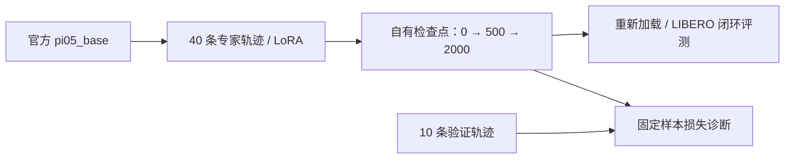
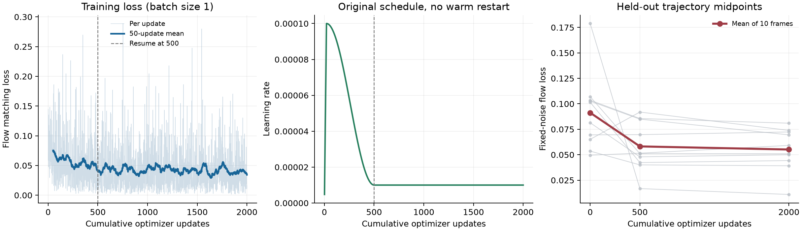
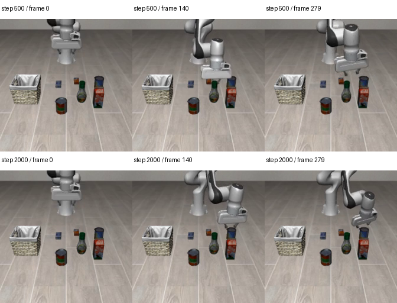

# π0.5 LoRA → LIBERO：训练与闭环评测复现

从 OpenPI 官方 `pi05_base` 出发，在 **RTX 3090 24GB** 上完成真实专家数据处理、LoRA 微调、检查点保存与恢复，以及 LIBERO-Object 闭环仿真。

**状态：完整流程已跑通；自己的第 0、500、2,000 步检查点在这组案例上均为 0/10。** 本项目记录一个小规模复现实验及其负结果，没有复现已收敛的官方策略。

> A small, auditable reproduction of π0.5 LoRA training and LIBERO closed-loop evaluation on one RTX 3090. The pipeline works; the evaluated pilot checkpoints have not solved the ten paired tasks.



## 实际结果

| 指标 | 第 0 步 | 第 500 步 | 第 2,000 步 |
|---|---:|---:|---:|
| Object 任务完成数 | 0/10 | 0/10 | 0/10 |
| 固定验证轨迹中点损失，10 帧均值 | 0.091266 | 0.058177 | 0.055123 |
| 固定训练轨迹中点损失，10 帧均值 | 0.088259 | 0.050647 | 0.048670 |

每个检查点评测 10 个任务，每任务 1 个回合。验证诊断每条验证轨迹只取一个固定中点，**不是全部验证集损失**。损失下降尚未转化为任务成功。



续训恢复了第 500 步的完整 AdamW 状态及全局步数，核对并衔接数据采样序列，再执行 1,500 次更新。原计划在第 500 步降到学习率下限，后续维持 **1e-5**；没有重启 warmup。该结果不等价于从头设置一个 2,000 步余弦退火计划。

## 完成了什么

- **数据**：固定版本的真实 LIBERO-Object 专家数据；40 条训练轨迹 / 5,934 帧，10 条独立验证轨迹 / 1,452 帧。50 个文件均通过 SHA256 核验。
- **适配**：复用官方 LIBERO 输入输出变换，归一化只由训练轨迹拟合；动作块不跨越轨迹边界。
- **训练**：调用固定版本 OpenPI 的初始化、梯度更新和检查点接口；仅训练 LoRA，共 49,987,584 个可训练参数，约占 1.47%。
- **校验**：所有原始参数冻结，训练前后逐张量哈希相同；20 个 LoRA 张量全部发生变化。
- **检查点**：保存完整状态，导出独立 LoRA，并在 CPU 上实际验证基础权重与 LoRA 的参数树重建。
- **闭环评测**：从完整检查点重新加载策略，完成 30 个有效仿真回合，保存视频、动作、状态、延迟和逐任务判定。
- **实验记录**：保留初始化接口错误与首次推理心跳超时的失败记录，未将无效回合计为有效策略失败。

## 视频

下图及视频使用任务顺序中的第一个任务，选择与成败无关。



- [第 0 步与第 500 步视频](assets/step0-vs500.mp4)
- [第 500 步与第 2,000 步视频](assets/step500-vs2000.mp4)

## 目录

```text
configs/          固定数据清单、代码版本、训练协议和参考归一化
scripts/          可配置工作目录的运行入口与离线核验
  pilot500/       从基础权重训练 500 步
  continuation2000/  恢复到累计 2,000 步
records/          原始实验文件快照、日志、视频、参数哈希、失败记录
assets/           README 使用的训练曲线与配对视频
environment/      实际运行环境快照与安装依赖
models/           独立权重的文件名、大小和 SHA256；权重不进入普通 Git
docs/             复现、结果解读、GitHub 上传说明及此前部署实验
third_party/      上游许可证副本
```

`records/` 保留原始内容及历史云端路径，供审计使用。可移植代码位于 `scripts/`，默认将运行数据写到被 Git 忽略的 `runtime/`；也可设置 `PI05_WORKDIR`。**已完成的 GPU 结果来自 `records/*/scripts/` 的原始脚本。整理后的运行入口只做了离线、路径与 CPU 导入检查，没有重新执行完整训练。** 具体检查范围见 [整理与验证记录](docs/PACKAGING_VALIDATION.md)。

## 快速查看与复现

仅核验已有实验，无需 GPU，也无需安装 JAX：

```bash
python scripts/check_artifacts.py
python scripts/pipeline.py train2000 --dry-run
```

重新下载数据、训练和评测请按 [复现说明](docs/REPRODUCE.md) 操作。执行目标为 Linux 单卡环境，训练 Python 3.11 / JAX，仿真 Python 3.10 / MuJoCo；不在 GitHub Actions 中运行训练。

## 模型与数据来源

| 项目 | 使用内容 |
|---|---|
| 训练起点 | OpenPI 官方 `gs://openpi-assets/checkpoints/pi05_base` |
| 代码 | [Physical-Intelligence/openpi](https://github.com/Physical-Intelligence/openpi)，固定 commit |
| 专家数据 | [physical-intelligence/libero](https://huggingface.co/datasets/physical-intelligence/libero)，固定 revision |
| 仿真 | [LIBERO](https://github.com/Lifelong-Robot-Learning/LIBERO)，固定 commit |
| 模型设置 | π0.5，horizon=10，`discrete_state_input=False` |
| LoRA | PaliGemma rank=16，动作专家 rank=32；原始参数全部冻结 |

本次自己的微调从 `pi05_base` 开始。此前直接测评过的官方 `pi05_libero` 是另一套已经微调的权重，其结果归入 [历史部署参考](docs/prior-deployment/README.md)。没有使用 `lerobot/pi05_libero_base` 作为本次训练起点。

## 解释范围

本项目用于展示可核验的工程复现过程：基础权重 → LoRA 训练 → 自有检查点 → 仿真验证。单个训练种子、少量示范、每任务一个初始状态，不构成正式 benchmark 或稳定成功率结论。仿真状态与专家示范采集状态的重叠未审计；重复查看同一组案例后的续训比较属于探索性实验。

下一步值得检查动作与控制器对齐、扩大验证诊断覆盖，并分别研究学习率和数据量的影响。它们是后续计划，尚未执行。

- [详细结果与限制](docs/RESULTS.md)
- [模型、数据和实现说明](docs/MODEL_AND_DATA.md)
- [权重获取与恢复](models/README.md)
- [下载本轮 LoRA 权重（Release）](https://github.com/12345dghdheb/pi05_libero_lora_reproduction/releases/tag/v0.1.0-pilot)
- [上传到 GitHub](docs/GITHUB_UPLOAD.md)
- [上游许可与引用](THIRD_PARTY_NOTICES.md)

## 许可

上游代码与模型、数据适用各自许可，见 [声明](THIRD_PARTY_NOTICES.md)。当前未替项目作者选择新增代码的独立开源许可证。
